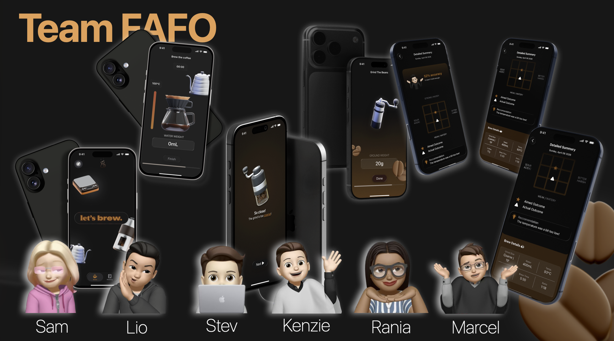
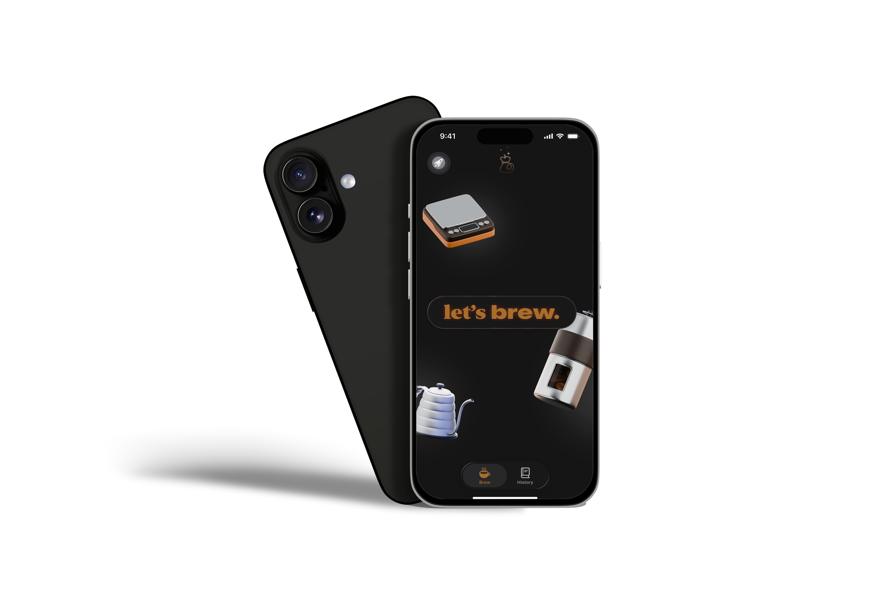
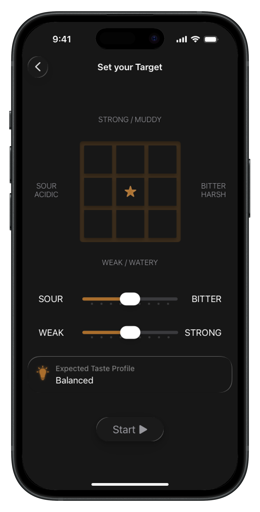
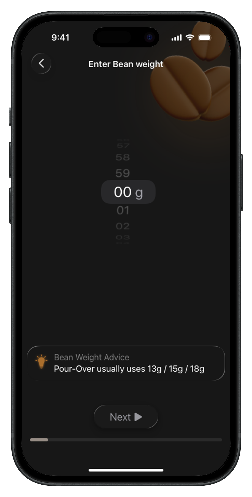
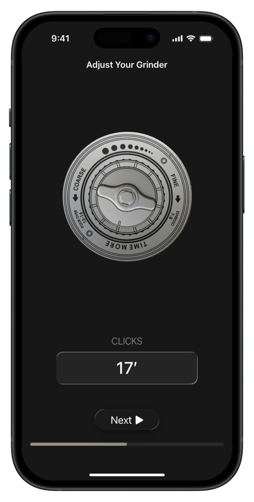
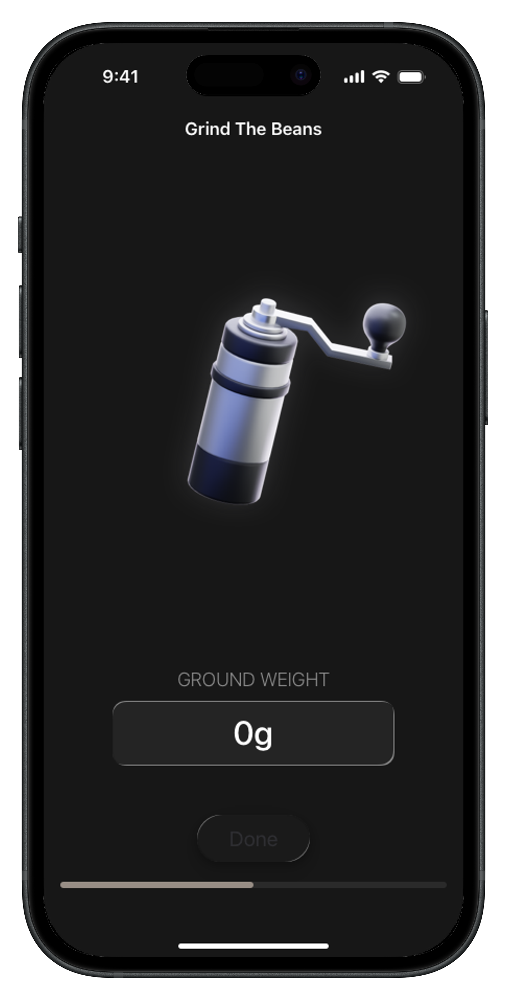
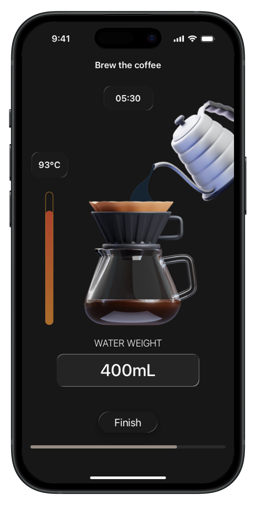
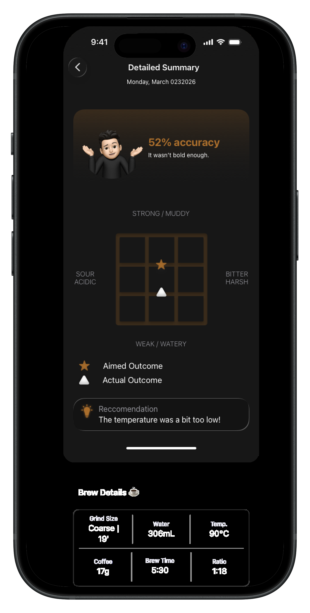
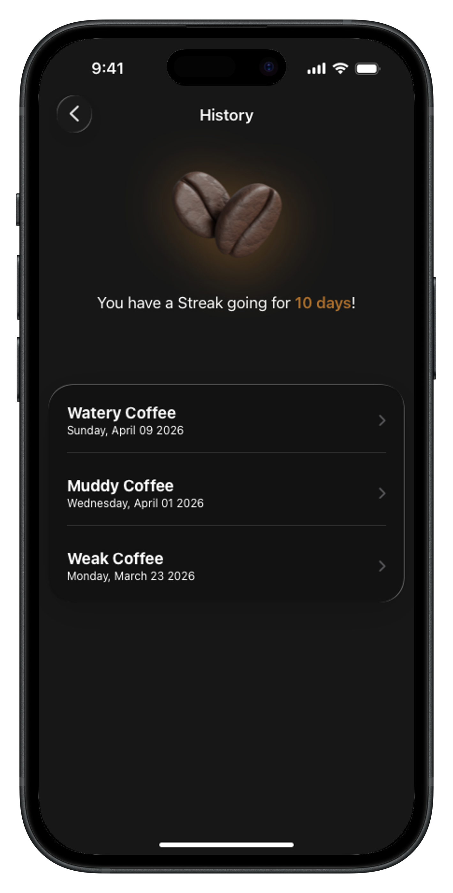

# Coffi

**Learn to manually brew coffee by taking part in the process, through a simulation game.**

Coffi is a high-fidelity iOS app prototype designed by Team FAFO, a team of six, for **Challenge 1 (Help an Academy Friend)** at Apple Developer Academy @ BINUS – Bali.

> This was a design-only challenge, so this repo contains the design work (screens and pitch deck), not code.

## The Problem

We chose to help one of our Academy friends, who was interested in learning about coffee and dreams of opening a coffee shop one day, but didn't have enough resources to learn.

## The Solution

Coffi turns learning manual brewing (pour-over) into a guided simulation. Instead of only reading about it, our friend takes part in every step of the process and sees how each choice affects the taste.

Following Apple's principle of designing with empathy, we shaped the experience around our friend's needs rather than our own preferences.

## How It Works

1. **Set your target:** choose the taste you want between sour and bitter, and between weak and strong
2. **Enter bean weight:** with advice on common pour-over amounts
3. **Adjust your grinder:** set the grind size in clicks on the grinder dial
4. **Grind the beans:** track the ground weight
5. **Brew the coffee:** follow the timer, water temperature, and water weight
6. **Detailed summary:** compare the aimed and actual outcome, with an accuracy score, a recommendation, and the brew details
7. **History:** review past brews and keep a brewing streak

## Screens

  

<table>
  <tr>
    <td align="center"> Set your Target</td>
    <td align="center"> Bean Weight</td>
    <td align="center"> Adjust Grinder</td>
    <td align="center"> Grind the Beans</td>
  </tr>
  <tr>
    <td align="center"> Brew the Coffee</td>
    <td align="center"> Detailed Summary</td>
    <td align="center"> History</td>
    <td></td>
  </tr>
</table>

## Design Process

As a design-only challenge, every team member designed their own version of the app, and we then combined the best parts into one hi-fi prototype.

## Team FAFO

Sam · Lio · Stev · Kenzie · Rania · Marcel

All members worked as designers on this challenge.

## Tools

- Sketch (UI design and hi-fi prototype)
- Keynote (pitch deck)
